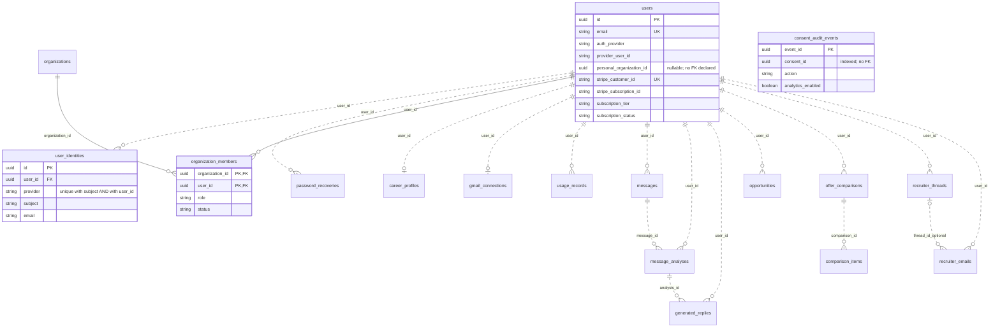

# RecruiterReply PostgreSQL schema
Source-derived view of current main, checked 2026-11-18. Not a live database introspection.
17 application tables; 18 declared foreign-key relationships. Selected columns only.

## Evidence
- [EF model](https://github.com/moojjoo/recruiterreply/blob/0a320426862cbaafb1ccb51e79b4a5b2c123ca97/backend/Data/RecruiterReplyDbContext.cs)
- [Migration snapshot](https://github.com/moojjoo/recruiterreply/blob/0a320426862cbaafb1ccb51e79b4a5b2c123ca97/backend/Migrations/RecruiterReplyDbContextModelSnapshot.cs)
- Current-main snapshot blob matches pinned source: 6fb7c97062d29a8c66d9343b446626286e01c974.
- [BFF session storage](https://github.com/moojjoo/recruiterreply/blob/0a320426862cbaafb1ccb51e79b4a5b2c123ca97/backend/Services/BffSessionStore.cs): DynamoDB, not PostgreSQL.

## Reading the diagram
Every modeled FK uses cascade delete. Required parent is exactly one; its children can be zero or more.
A user has at most one career profile and one Gmail connection (unique user_id indexes).
Recruiter email thread_id is optional; an email need not have a recruiter_threads parent.
organization_members joins users and organizations via a composite primary key.
Messages/analyses/replies each also carry their own required user_id FK.
Consent audit is standalone, not linked to users by a database FK.
users.personal_organization_id is stored but no relationship is declared in this model/snapshot.
No FK connects comparison_items to opportunities or recruiter_threads to gmail_connections.

## Key constraints
- users.email unique (ordinary string index, not proof of case-insensitive identity semantics).
- users(auth_provider, provider_user_id) unique; stripe_customer_id unique.
- user_identities(provider, subject) unique AND (user_id, provider) unique: one identity per provider per user.
- usage_records(user_id, feature, period_start) unique.
- recruiter_threads(user_id, gmail_thread_id) unique.
- recruiter_emails(user_id, gmail_message_id) unique.
- message_analyses competitiveness_score checked between 1 and 10.

## Scope caveats
This document describes the code model, not a verified deployed database. No live schema metadata or customer rows were read.
No customer rows, credentials or tokens were accessed. EF migration-history metadata table is omitted.
Local-only identity_link_* and identity_session_fences experiments are NOT part of this current-main diagram.
Billing/subscription fields are on users; there is no separate subscription/payments table in this EF model.

## Maintaining this diagram
Update this file **in the same pull request** whenever entities, EF mappings, migrations, or the migration snapshot change. This is a manual review contract, not an installed automatic generator or CI check.

- [ ] Compare `backend/Data/RecruiterReplyDbContext.cs`, entity types and `backend/Migrations/RecruiterReplyDbContextModelSnapshot.cs` after generating migrations normally.
- [ ] Enumerate every `ToTable` and `HasForeignKey` in the snapshot. Reconcile the table/relationship counts, names and endpoints.
- [ ] Recheck nullable foreign keys, composite primary keys and unique indexes; do not infer a relationship from an `*_id` column alone.
- [ ] Use Mermaid `--` only for identifying relationships (FK belongs to child PK); use `..` otherwise. Recheck cardinality separately.
- [ ] Update selected key fields, important constraints, immutable source links, reviewed date and snapshot blob fingerprint. A blob ID identifies file contents, not a release or deployment.
- [ ] Review migrations containing raw SQL for schema objects outside the EF model. Explicitly document any additional scope or exclusions.
- [ ] Preview this Mermaid block in GitHub and independently compare it with the changed model/snapshot before approving the PR.
- [ ] Keep experimental/unmerged models out of the current diagram. Do not label it live unless read-only catalog metadata was actually checked for a named environment/release.
- [ ] Record the diagram update or a reasoned “no diagram change” in every schema-changing PR.

Current manual verification: the table/FK inventory and nullable/unique constraints were compared with both model and snapshot, then independently reviewed. No live DB test or automatic drift check is claimed. The historical [DATABASE_SCHEMA.md](DATABASE_SCHEMA.md) contains earlier design SQL and is not the current EF-model inventory.
