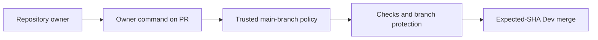
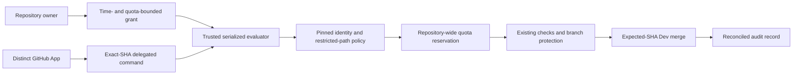

# Disabled Dev delegation design

Status: **draft contract, disabled**. Issue: #704.

This proposal defines a narrow GitHub App identity that may eventually authorize eligible Dev-only merges under an owner-issued grant. It does not activate that authority. The checked-in policy has `enabled: false`, contains no live identity, and the accompanying workflow has read-only permissions and no merge, dispatch, comment, deployment, or environment capability.

## Security invariants

- The owner remains the only principal able to create or revoke a grant. A grant lasts no more than eight hours and covers no more than five successful Dev merges.
- A delegated command names the linked issue, full 40-character current PR head SHA, and grant ID. Branch names, PR bodies, labels, display names, and partial SHAs convey no authority.
- Identity validation requires the configured repository, numeric App ID, installation ID, numeric bot user ID, exact bot login, and `Bot` actor type. Any missing field fails closed.
- The future write-capable evaluator must check out policy from the trusted default branch and must never execute PR-supplied code, Actions, policy, configuration, or scripts with write credentials.
- Delegation never recognizes Test or Production commands. The App must lack Contents, Actions, Deployments, Administration, and environment-review permissions.
- Auth, identity, billing, payments, Stripe, security, infrastructure, migrations, dependencies, workflows, scripts, deployment, release, deletion, rename, copy, binary, oversized, fork, and unknown changes are outside delegated scope.
- Authorization is evaluated again against the final PR state immediately before an expected-SHA protected merge. Existing checks, reviews, unresolved-thread checks, branch protection, and issue/project readiness remain mandatory.

## Grant and quota state

The proposed command forms are:

```text
/grant-guru-dev 8h 5
/revoke-guru-dev gd_<16 lowercase hex characters>
/guru-execute-dev <issue> <40-character lowercase head SHA> gd_<16 lowercase hex characters>
```

All grant mutations and reservations must run under one repository-wide, non-cancelling concurrency group. Before attempting a merge, the evaluator creates a scope-bound `pending` reservation. A retry with the same run/attempt reservation ID is idempotent; reuse for another PR or SHA is rejected. A confirmed successful merge consumes the reservation. A definitive pre-merge or merge rejection releases it. An uncertain outcome remains pending until reconciliation checks the PR merge SHA; it must not be optimistically released. Pending plus consumed reservations count against the quota, preventing concurrent oversubscription across PRs and grants.

## Audit limitations

GitHub issue comments can provide a durable, human-readable ledger, but repository users with suitable permissions can edit or delete them. The ledger is therefore **not immutable evidence**. Activation must select an integrity anchor, such as append-only external storage or signed records whose digests are retained outside the editable issue, and define retention, reconciliation, and incident response. Records must include numeric trusted author/App/installation IDs, repository, control issue, grant, command comment, PR, issue, exact SHA, policy revision/digest, reservation transitions, merge result, and timestamps.

## Current and proposed flow

Current owner-only flow:



Proposed bounded flow after separate activation:



## Activation remains a separate security change

Merging this draft cannot activate delegation. Activation requires all of the following in a later owner-approved change:

1. Create a dedicated GitHub App and verify its requested least-privilege permissions before installation. No App or credential is created by this PR.
2. Capture a real App-authored `issue_comment` event and REST comment response. Confirm the exact, stable locations and types of `performed_via_github_app`, installation ID, numeric bot user ID, actor type, and bot login. Mock tests here do not establish that live contract.
3. Pin those observed identifiers and a dedicated owner-controlled grant issue in reviewed source. Missing identity fields must continue to fail closed.
4. Select and test an audit integrity anchor and recovery/revocation procedure.
5. Implement the write-capable evaluator as a separately reviewed patch. It must reuse the existing expected-SHA protected merge path, preserve every readiness gate, and add repository-wide reservation/reconciliation. Enabling the JSON flag alone is insufficient because this draft workflow has no write capability.
6. Test the installed App's negative permissions live: push, merge, workflow dispatch, environment approval, ruleset administration, and Test/Production deployment must return denial.
7. Obtain explicit owner approval for the final source diff, App permissions/installation, pinned identifiers, control issue, audit store, and activation time window.

Rollback is immediate revocation of the App installation and all open grants, followed by disabling the separately introduced evaluator. The existing owner-only path remains available and unchanged.
